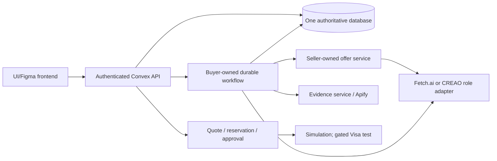

# BuyerUnion: PRD and two-developer backend handoff

Version 5 | October 24, 2026 | Working implementation specification

**Outcome:** a buyer confirms one shopping request; isolated seller agents prepare policy-valid offers; the platform checks requirements and evidence; the buyer chooses and explicitly approves exact terms; the prototype records a truthful simulated order.

This document replaces v4's implementation direction. The complete original is preserved in `buyerunion-prd-v4-source.md`; the PDFs remain unchanged. Everything needed to build the backend is specified here. The archive is history, not a second active specification.

## 1. Confirmed changes and decisions left to the team

| Topic | Current decision |
|---|---|
| Developers | Exactly two backend/data/agent developers: **S owns seller services; B owns buyer services and the workflow**. Neither owns screen design or frontend implementation. |
| UI ownership | The UI/Figma team owns layouts, interaction design and frontend implementation. Backend developers provide contracts, safe view data, fixtures and integration support. Screen descriptions below identify capabilities and states, not prescribed designs. |
| Agents | Support **Fetch.ai or CREAO AI** behind the same application contracts. The team chooses the provider for each role and may use both. No fixed buyer-provider/seller-provider assignment. |
| Previous model | Gemini is removed from the active stack, configuration and implementation tasks. No direct Gemini integration or Gemini prize target. A framework such as uAgents still needs an explicitly chosen non-Gemini reasoning capability if the agent is to interpret language. |
| Fetch eligibility | The user has confirmed that a custom UI with Fetch agents is acceptable and that the previous eligibility limitation is nonblocking. Do not require ASI:One as the primary UI or exclude Fetch because of the old PRD. This records team-provided guidance, not independent organizer verification. |
| Hosting | Mana is the selected hosting direction. The team will determine the exact service, runtime and prize details. This handoff specifies deployable components and configuration, not Mana-specific commands. Vultr is no longer the deployment target. |
| Coinbase | Optional add-on/prize candidate after the core path works. It is not required to submit requests, receive offers or complete simulated checkout. No real-wallet funding or live transfers are included in this plan. |
| Retained defaults | React/Vite UI contract, TypeScript/Convex backend, one authoritative database, durable Workflow orchestration, Convex Auth and Apify evidence acquisition. These are implementation defaults retained from v4, not new user mandates. |
| Commerce | Disclosed fictional merchants, stock, prices and terms; real applicable web evidence; simulation by default. Visa sandbox only if a supported operation is tested and truthfully represented. |
| Product breadth | Manufactured products across technology, clothing, household accessories and small appliances. Laptops are the first complete integration case, not the product boundary. |

**How to use this handoff:** freeze section 5 together, build the first end-to-end path in section 15, then add the remaining behavior. Provider role allocation and Mana details do not block contract or deterministic backend work. A real supported provider call is required before claiming live AI integration.

## 2. Product requirements and scope

BuyerUnion is like asking several stores for a suitable offer without repeating the same requirements at every counter. The buyer describes an outcome; seller agents search their own catalogs and may make permitted concessions; the platform explains the differences and keeps the buyer in control.

### Buyer capabilities

1. Start an anonymous authenticated session and save an ordinary-language prompt, up to 4,000 characters.
2. Receive at most three grouped clarification turns and an editable proposed brief. Budget and deadline start unset. “Around $1,000” is not a hard maximum until confirmed.
3. Confirm requirements, all-in private maximum, delivery area/deadline, conditions, quantities and optional preferences. An optional shared target needs separate explicit consent and cannot exceed the maximum.
4. Start, observe, cancel or revise a persisted request. Reload resumes progress. Revision creates a new immutable request version.
5. Compare qualified offers using complete delivered totals, fit checks, commercial terms and applicable evidence. Missing evidence remains visible.
6. Select an offer, receive a current firm quote and temporary stock hold, and approve the exact quote. No agent can approve for the buyer.
7. Receive a simulated success, definite decline or unresolved result with correct recovery behavior.

### Seller capabilities

1. A privately provisioned operator accesses only its merchant's inventory, policy and offer activity.
2. Update permitted listing data, publish a versioned pricing/service policy and pause new participation.
3. A seller agent searches only that merchant's inventory, checks its authority, proposes a bundle and explains suitability.
4. Respond to one useful claim challenge and, when warranted, submit one sealed final price revision. Holding price or abstaining is valid.
5. See safe validation reasons and own private contribution calculations, without buyer ceilings or competitor costs/floors.

### Bounds retained from v4

- Three fictional merchants; at most two active candidates each; at most five final offer cards. The UI may emphasize fewer, but must not silently hide better offers without explaining its shortlist rule.
- One primary product line and up to two related lines per request, all fulfilled by one merchant. Line quantities are integers 1–10. The first integration case is one primary line; related-line support follows through the same contract.
- U.S./USD, San Francisco delivery; prices stored as integer cents. Fictional prices are tax-inclusive, with tax zero labeled “included in demo price”; shipping is charged once per seller bundle.
- Supported condition is explicit per category. Unsupported categories stay drafts. Services, consumables, regulated goods and installation promises are excluded.
- No live-money purchases, real fulfillment, multi-seller checkout, escrow, refunds, credit scoring, voice/photo input or arbitrary third-party agent registration.
- One council round is sufficient for the required demo. A second verification-only round is optional and disabled initially. No repeated price auctions.

## 3. Ownership: one owner for every write

Treat the handoff like a relay: S produces a validated seller offer; B decides whether that offer is affordable, presents it, and manages buyer authority. Both use the same rules for product eligibility and stock, rather than implementing competing versions.

| Component | Owner | Deliverable / boundary |
|---|---|---|
| Shared contract package, API/error naming | B maintains; S reviews | One schema source, generated types/fixtures, version policy. Agree changes before merging. |
| Category profiles, products, variants, seed data | S | Typed attributes, compatibility rules, provenance and all four profile families. |
| Merchant membership and seller authorization | S | Own-merchant queries/mutations and internally provisioned membership. B provides shared auth foundation. |
| Listing/policy writes and price validation | S | Immutable versions; floor/cap/contribution checks; service terms from policy. |
| Seller agent integration and scoped tools | S | Provider-neutral job input/output, seller invocation, own-catalog tools, proposal/response/final-bid handling. |
| Requirement eligibility and fit calculation | S | Shared deterministic functions reused at intake validation, offer acceptance, evidence revalidation and checkout. B must not fork them. |
| Buyer authentication, drafts and confirmation | B | Own-request auth, private maximum, requirement provenance, sanitized seller projection. |
| Durable run coordinator and deadlines | B | Sole writer of run stages, cancellation, stale-work checks and phase closure. |
| Council coordination / feedback | B | Selects material challenges; S executes seller responses and validates revisions. |
| Price round | B coordinates; S validates | B freezes participants and closes the round; S stores private submissions through one validated internal boundary. |
| Independent evidence and applicability | B | Real source acquisition, caching, provenance and safe completion. S supplies product identity and reevaluates affected eligibility. |
| Buyer comparison / shortlist | B | Safe view projection and shared deterministic ordering using S's fit results. |
| Stock allocations / reservations | S | Sole stock arithmetic and allocation transitions. B calls S's transaction helpers from selection/execution mutations. |
| Firm quote / approval / execution / orders | B | Exact-term snapshot, buyer consent, idempotent simulation and reconciliation. |
| Provider adapter shared shape | B maintains interface; each owner implements role | No duplicated provider assumptions or provider-specific payloads in UI contracts. |
| Frontend and design | UI/Figma team | Uses public queries/actions; displays server totals, status, modes and allowed actions. No seller secrets in buyer fixtures. |
| Hosting/config readiness | B coordinates; S supplies agent service requirements | Mana mapping is team-owned; no deployment credentials or external changes performed by this document. |

**Transactional rule:** S's reservation helpers execute inside B's selecting/approving/settling Convex mutations. They must not perform network calls or create a second transaction boundary. S owns allocation logic; B owns the enclosing buyer lifecycle. This prevents a quote without a hold or a successful order without a sold allocation.

## 4. Runtime and trust boundaries



- The browser never calls privileged provider APIs or receives keys. Providers produce proposals; deterministic backend code decides what may enter state.
- A seller job contains a sanitized common brief plus only its own inventory/policy. The raw prompt and private ceiling are excluded. A provider session is isolated per request/run/role/merchant; no conversation is reused across merchants or buyers.
- Intake may see the buyer's private prompt because it works for the buyer. The seller projection is built from approved fields, not by asking a model to redact a paragraph.
- Evidence workers are read-only with respect to commerce. Source text cannot change policy, call payment, disclose secrets or approve an order.
- All external network/model/crawl calls occur in actions or provider workers. Mutations enforce state atomically. Persistent records, not agent memory, decide what has happened.
- Fetch may require a separately deployed Python service. Do not assume a static host runs that service or that a Convex action hosts a long-running Python process. Mana's final runtime mapping is a deployment follow-up, not an invented capability.

## 5. Shared contracts: draft to freeze before parallel implementation

These are **application-owned contracts**, not vendor API examples. The names and fields below define the handoff. Use JSON-compatible values only: no `Date`, `Map`, `Set`, class instances or `undefined` on the wire. Missing nullable values use `null`.

Implementation task F0 must produce a single runtime-validated contract package and a checked-in JSON Schema export for any Python worker. TypeScript types and worker validation derive from that same source. Do not hand-maintain a second Python interpretation. Strictly reject unknown fields at permission-sensitive boundaries. The snippets below are a design draft, not a compiled package or passing tests.

### 5.1 Primitives, categories and confirmed requests

```ts
type Id = string;             // Opaque, nonempty; never authority by itself.
type Cents = number;          // Safe integer, >= 0; budgets/targets must be > 0.
type Ms = number;             // Safe integer UTC Unix milliseconds.
type Version = number;        // Integer >= 1.
type Category = "laptop" | "tech_accessory" | "clothing"
  | "household_accessory" | "small_appliance";
type Condition = "new" | "refurbished";
type Value = string | number | boolean | string[];
type Sort = "best_fit" | "cheapest" | "soonest" | "warranty";
type Ref = { id: Id; version: Version };

interface ProfileField {
  id: string;
  label: string;
  kind: "string" | "number" | "boolean" | "string_array";
  unit: string | null;
  allowedOperators: Requirement["operator"][];
  allowedValues: string[] | null;
  minimum: number | null;
  maximum: number | null;
}
interface CategoryProfile {
  profile: Ref;
  category: Category;
  allowedConditions: Condition[];
  fields: ProfileField[];
  variantKeyFields: string[];
  compatibilityRuleId: string | null; // Key of a reviewed server rule, not code.
  evidenceRuleId: string;
}
interface Requirement {
  id: Id;
  fieldId: string;
  operator: "equals" | "in" | "min" | "max" | "containsAll";
  value: Value;
  unit: string | null;
  strength: "hard" | "soft";
  weight: 1 | 2;             // 2 only for a buyer-confirmed top preference.
}
interface RequirementOrigin { // Private: never sent to a seller.
  requirementId: Id;
  messageId: Id;
  start: number; end: number; // Offsets in the original message.
  explicit: boolean;
  buyerConfirmed: boolean;
}
interface RequestLine {
  lineId: Id;
  role: "primary" | "related";
  category: Category;
  profile: Ref;
  quantity: number;
  allowedConditions: Condition[];
  requirements: Requirement[];
  useCaseSummary: string;     // Confirmed, allowlisted wording; no raw prompt.
}
interface SharedTarget {
  amountCents: Cents;
  consentId: Id;
  consentedAt: Ms;
}
interface ConfirmedBrief {
  schemaVersion: 1;
  request: Ref;
  currency: "USD";
  deliveryRegion: "US-CA-SAN_FRANCISCO";
  deliveryDeadline: Ms;
  lines: RequestLine[];
  sharedTarget: SharedTarget | null;
}
interface SellerBrief extends ConfirmedBrief { runId: Id }
interface RequestVersion {
  schemaVersion: 1;
  request: Ref;
  ownerId: Id;
  createdAt: Ms;
  rawMessages: { id: Id; text: string }[];
  origins: RequirementOrigin[];
  privateMaximumCents: Cents;
  confirmedAt: Ms;
  sort: Sort;
  brief: ConfirmedBrief;
}
```

The request stores `ConfirmedBrief`. The coordinator creates a `SellerBrief` by attaching the new run ID, without mutating the confirmed request. Store the confirmed public requirement fields once and derive projections, rather than storing conflicting mutable copies. Reviewed server registries supply unit conversions, compatibility and applicability behavior referenced by a profile.

Drafts may be incomplete. `confirmRequest` cannot accept missing private maximum, deadline, region, profile or unresolved hard requirement. A provider proposes extraction; the buyer's authenticated confirmation establishes the request. Client-provided `ownerId`, `confirmedAt`, version and consent timestamps are ignored and set by the server.

### 5.2 Catalog, policy and seller proposal

```ts
interface Attribute {
  value: Value | null;
  unit: string | null;
  provenance: "manufacturer" | "real_report" | "synthetic_demo";
  sourceId: Id | null;
}
interface CatalogVariant {
  id: Id;
  productId: Id;
  title: string;
  category: Category;
  profile: Ref;
  manufacturerPartNumber: string | null;
  attributes: Record<string, Attribute>;
  syntheticProduct: boolean;
}
interface Listing {
  listing: Ref;
  merchantId: Id;
  variantId: Id;
  condition: Condition;
  unitId: Id | null;
  initialQuantity: number;
  referenceUnitCents: Cents;
  operatorFloorCents: Cents;   // Seller/private only.
  diagnosticAttributes: Record<string, Attribute>;
}
interface PricingPolicy {
  policy: Ref;
  merchantId: Id;
  enabled: boolean;
  maxDiscountBps: number;
  unitCostByListing: Record<Id, Cents>;
  minimumContributionByListing: Record<Id, Cents>;
  costsAreSynthetic: boolean;
  shippingCents: Cents;
  arrivalCalendarDays: number;
  warrantyMonths: number;
  returnDays: number;
}
interface OfferLine {
  requestLineId: Id;
  listing: Ref;
  quantity: number;
  unitCents: Cents;
}
interface Claim {
  id: Id;
  requestLineId: Id;
  text: string;
  sourceIds: Id[];
}
interface SellerProposal {
  schemaVersion: 1;
  jobId: Id;
  candidateId: Id;            // Stable across revisions, server-issued.
  parentOffer: Ref | null;
  policy: Ref;
  lines: OfferLine[];
  claims: Claim[];
  fitArgument: string;
  privatePriceRationale: string;
}
type SellerDecision =
  | { kind: "propose"; proposal: SellerProposal }
  | { kind: "hold"; jobId: Id; offer: Ref }
  | { kind: "abstain"; jobId: Id; reasonCode: string };
```

No merchant ID in a model output grants scope. The authenticated job record binds merchant, request, run, phase and candidate. `policy` and listing versions must match approved snapshots. S computes identity, delivered total, eligibility, contribution, arrival and service terms; the agent cannot supply authoritative totals or rewrite terms in prose. Initial calls receive up to two server-issued candidate IDs. A repair/revision reuses its candidate ID and names its parent version.

### 5.3 Validated offer and UI-safe comparison data

```ts
interface RequirementCheck {
  requirementId: Id;
  status: "matched" | "unmet" | "unknown";
  actual: Value | null;
  sourceIds: Id[];
  explanation: string;
}
interface FitAssessment {
  checks: RequirementCheck[];
  coveragePercent: number | null;
  hardRequirementsPass: boolean;
  scoringVersion: 1;
}
interface OfferVersion {
  offer: Ref;
  candidateId: Id;
  request: Ref;
  runId: Id;
  merchantId: Id;
  policy: Ref;
  lines: OfferLine[];
  claims: Claim[];
  fitArgument: string;
  fit: FitAssessment;
  itemsCents: Cents;
  shippingCents: Cents;
  taxCents: 0;
  totalCents: Cents;
  arrivalAt: Ms;
  warrantyMonths: number;
  returnDays: number;
  acceptedAt: Ms;
  expiresAt: Ms;
  policyValid: boolean;
  requirementsValidExceptBudget: boolean;
  // Computed by B; never projected into seller tools:
  affordable: boolean;
  selectable: boolean;
}
type EvidenceStatus = "pending" | "complete" | "partial" | "unavailable" | "cached";
interface OfferCard {
  offer: Ref;
  merchant: { id: Id; displayName: string; demo: true };
  products: {
    requestLineId: Id; variantId: Id; title: string;
    condition: Condition; quantity: number;
  }[];
  totalCents: Cents;
  initialTotalCents: Cents;
  currency: "USD";
  arrivalAt: Ms;
  warrantyMonths: number;
  returnDays: number;
  fit: FitAssessment;
  fitArgument: string;
  mainConcern: string | null;
  evidenceStatus: EvidenceStatus;
  evidenceIds: Id[];
  expiresAt: Ms;
  selectable: boolean;
  unavailableReason: string | null;
}
```

`OfferVersion` is an internal persisted record, not a response to a seller. Seller views must explicitly project own public terms and safe reasons, omitting `affordable`, `selectable`, private ceiling and private-constraint rejection details. A generic rejection must not print a buyer price or budget headroom. Buyer cards omit floors, costs, private rationales, raw prompts and provider payloads.

### 5.4 Evidence, run events and frontend view

```ts
interface Evidence {
  id: Id;
  variantId: Id;
  applicability: "exact_variant" | "family";
  sourceType: "manufacturer" | "independent_test" | "owner_report";
  url: string;
  sourceDate: string | null;
  retrievedAt: Ms;
  claim: string;
  excerpt: string;
  sourceVerifiedPurchaseLabel: string | null;
  verification: "supported" | "contradicted" | "unknown";
  providerRunId: string;
  providerBuild: string;
  duplicateGroup: string;
}
type RunStage = "bidding" | "council" | "negotiating" | "researching"
  | "results" | "no_match" | "cancelled" | "failed";
type PurchaseStage = "none" | "reserved" | "executing" | "unknown"
  | "complete" | "declined";
interface RunEvent {
  id: Id; request: Ref; runId: Id; sequence: number; createdAt: Ms;
  kind: "started" | "proposal" | "rejected" | "challenge" | "response"
    | "revision" | "price_round_opened" | "final_bid" | "abstained"
    | "price_round_skipped" | "research_updated" | "closed";
  merchantId: Id | null;
  offer: Ref | null;
  summary: string;           // Sanitized outcomes, not private reasoning.
}
interface BuyerRunView {
  request: Ref;
  runId: Id;
  stage: RunStage;
  purchaseStage: PurchaseStage;
  startedAt: Ms;
  updatedAt: Ms;
  serverNow: Ms;
  participatingMerchantCount: number;
  completedMerchantCount: number;
  evidenceStatus: EvidenceStatus;
  partial: boolean;
  offers: OfferCard[];
  events: RunEvent[];
  allowedActions: ("cancel" | "revise" | "select" | "approve" | "retry")[];
  modes: {
    inventory: "mock";
    agents: "live" | "fixture";
    evidence: "live" | "cached" | "mixed" | "unavailable";
    payment: "simulation" | "visa_sandbox";
  };
  error: ApiError | null;
}
```

The view returns a bounded recent event window with a cursor for earlier safe events; events sort by server sequence, not provider timestamps. Persist per-job provenance so mixed live/fixture work is labeled in details; never label a partially fixture-driven run simply “live.” During bidding/research, offers may appear as previews with `selectable=false`; only finalized/revalidated results allow selection. `serverNow` is observational; the server checks expiry on every write.

Price rounds have a persisted handoff contract as well:

```ts
interface PriceRound {
  id: Id; request: Ref; runId: Id;
  mode: "competitive" | "single_seller_target";
  participants: { merchantId: Id; candidateId: Id; initialOffer: Ref }[];
  openedAt: Ms; deadlineAt: Ms;
  status: "open" | "closed";
  closeReason: "all_responded" | "deadline" | "cancelled" | null;
}
interface FinalSubmission { // Internal; never exposed before round close.
  roundId: Id; candidateId: Id; jobId: Id;
  payloadDigest: string; receivedAt: Ms;
  decision: "revise" | "hold" | "abstain";
  validatedOffer: Ref | null;
}
```

An accepted final submission is private staging: do not promote the candidate's effective offer or emit public price details until B closes the round. Before close, safe events can show only receipt/status counts. On close, promote valid revisions atomically with round closure, or retain earlier offers. This rule applies to buyer previews, seller projections and event history alike.

### 5.5 Firm quote, execution and errors

```ts
interface FirmQuote {
  quoteId: Id;
  request: Ref;
  offer: Ref;
  merchantId: Id;
  policy: Ref;
  lines: OfferLine[];
  totalCents: Cents;
  shippingCents: Cents;
  taxCents: 0;
  currency: "USD";
  arrivalAt: Ms;
  warrantyMonths: number;
  returnDays: number;
  createdAt: Ms;
  expiresAt: Ms;
  quoteHash: string;
  reservationId: Id;
  paymentMode: "simulation" | "visa_sandbox";
  operation: string;
}
interface ExecutionView {
  executionId: Id;
  quoteId: Id;
  status: "pending" | "unknown" | "succeeded" | "declined";
  mode: "simulation" | "visa_sandbox";
  operation: string;
  providerReference: string | null;
  orderId: Id | null;
  resultMessage: string;
  nextAction: "wait" | "choose_offer" | "none";
}
type ErrorCode = "INVALID_INPUT" | "FORBIDDEN" | "STALE_VERSION"
  | "NO_MATCH" | "POLICY_REJECTED" | "EXPIRED" | "STOCK_UNAVAILABLE"
  | "PROVIDER_UNAVAILABLE" | "LIMIT_REACHED" | "EXECUTION_UNKNOWN";
interface ApiError {
  code: ErrorCode;
  message: string;
  retryable: boolean;
  correlationId: string;
}
type ApiResult<T> = { ok: true; value: T } | { ok: false; error: ApiError };

interface Reservation {
  id: Id; request: Ref; quoteId: Id; ownerId: Id;
  createdAt: Ms; expiresAt: Ms;
  state: "active" | "execution_locked" | "released" | "sold";
  executionId: Id | null;
}
interface Allocation {
  id: Id; reservationId: Id; listingId: Id; quantity: number;
}
```

Hash a canonical, versioned representation of exact terms, line identities/quantities, payment mode/operation and expiry. Do not hash display text or unnormalized floating-point values. B builds the hash server-side; approval submits the observed hash, never client-supplied replacement terms. Raw reservation internals remain private. Preserve variant/condition snapshots in the quote/order even if the current catalog later changes.

### 5.6 Agent provider boundary

```ts
type AgentProvider = "fetch" | "creao";
type AgentRole = "intake" | "seller_initial" | "moderator"
  | "seller_response" | "seller_final" | "evidence_summary";
interface AgentJob {
  jobId: Id;
  request: Ref;
  runId: Id | null;          // Intake precedes a run.
  role: AgentRole;
  merchantId: Id | null;     // Internal binding, never model-selectable.
  phaseId: Id;
  deadlineAt: Ms;
  provider: AgentProvider;
  inputDigest: string;
  inputRef: Id;              // Immutable scoped payload stored server-side.
}
type AgentJobResult<T> =
  | { status: "pending"; providerRunId: string }
  | { status: "completed"; output: T; providerRunId: string;
      model: string | null; elapsedMs: number }
  | { status: "failed"; error: ApiError; providerRunId: string | null };
interface AgentPort {
  start(job: AgentJob): Promise<AgentJobResult<unknown>>;
  poll(jobId: Id): Promise<AgentJobResult<unknown>>;
  cancel(jobId: Id): Promise<void>; // Best effort; stale completion is still ignored.
}
```

The port is an internal adapter seam, not a proposed public SDK. `unknown` is validated by the role's schema before use. An HTTP success/accepted response or provider run ID does not mean the role completed. Do not retry `start` blindly after an ambiguous timeout; poll/reconcile the existing job first. Job IDs deduplicate application results, but cannot guarantee provider billing idempotency. No automatic cross-provider failover that could run a job twice.

Role input/output contracts:

| Role | Allowed input | Output / restrictions |
|---|---|---|
| Intake | Own buyer conversation and current draft/profile definitions | Proposed draft fields, clarification questions and source spans. Cannot set confirmed timestamps or consent. |
| Seller initial | SellerBrief, server-issued candidate IDs, own read-only catalog/policy tools | SellerDecision; up to two candidates, scoped by job. |
| Moderator | Confirmed public requirements, permitted claims and approved sources | At most one `{claimId, offer, question}` challenge per merchant plus safe summary. No ranking or authority changes. |
| Seller response | Own latest offer, specific challenge and approved evidence | Corrected proposal or acknowledgment; changed goods/price require a new validated offer. |
| Seller final | Own current candidate and safe truthful market feedback | One hold, abstention or proposal revision per candidate/round. |
| Evidence summary | Deduplicated applicable excerpts and exact identity | Attributed positives/concerns referencing existing evidence IDs. Cannot invent a source or modify eligibility. |

Non-seller role outputs also validate against fixed shapes:

```ts
interface IntakeResult {
  expectedDraftVersion: Version;
  proposedLines: RequestLine[] | null;
  proposedDeadline: Ms | null;
  proposedPrivateMaximumCents: Cents | null;
  proposedSharedTargetCents: Cents | null;
  origins: RequirementOrigin[];
  clarificationQuestions: string[];
  unresolvedFields: string[];
}
interface DraftView {
  requestId: Id;
  draftVersion: Version;
  messages: { id: Id; text: string }[];
  interpretation: IntakeResult | null;
  confirmedRequest: Ref | null;
  updatedAt: Ms;
}
interface ChallengePlan {
  challenges: { offer: Ref; claimId: Id; question: string; sourceIds: Id[] }[];
  summary: string;
}
interface EvidenceSummary {
  variantId: Id;
  positives: { text: string; evidenceIds: Id[] }[];
  concerns: { text: string; evidenceIds: Id[] }[];
  gaps: string[];
}
```

Intake origins are proposals: `buyerConfirmed` must be false until the authenticated confirmation handler records it. Model-suggested target language is never consent. Limit clarification questions to the current grouped turn and at most three turns overall. Challenge references must belong to the current permitted offer and source set; enforce one challenge per participating merchant. Every summary evidence ID must identify an applicable source in the job input; reject invented references.

Fetch and CREAO can implement any role if their tested integration supports it. Team-selected provider/model IDs are server configuration. Disable Gemini explicitly in the chosen account/runtime if it otherwise defaults to it; inability to inspect a hosted provider's internal model must be disclosed rather than asserted as verified. A deterministic fixture adapter is allowed for development and labeled as such; it is not proof of Fetch/CREAO use.

## 6. Internal handoff functions and public API

All names are proposed Convex function/service names. Frontend clients call generated bindings, not a guessed vendor endpoint. Queries return owner-scoped views. Actions/mutations return `ApiResult<T>` for expected domain failures; unexpected errors are logged with a correlation ID and sanitized.

### Buyer public surface (B)

| Function | Caller payload | Result / behavior |
|---|---|---|
| `saveDraft` | `{requestId: Id\|null, expectedDraftVersion: number\|null, message: string}` | Draft ID/version and stored conversation. Reject lost-update conflicts. |
| `getDraft` | `{requestId}` | Own reactive DraftView for reload and confirmation; no run is required. |
| `interpretDraft` | `{requestId, expectedDraftVersion}` | IntakeResult stored against that draft version; proposed fields may be null/incomplete. Never starts seller work. |
| `confirmRequest` | `{requestId, expectedDraftVersion, lines, deliveryDeadline, privateMaximumCents, sharedTargetCents: Cents\|null, shareTarget: boolean, sort}` | Immutable request `Ref`; server records confirmation/consent. `shareTarget=false` requires null target. |
| `startRun` | `{request: Ref, clientKey: string}` | `{runId}`; same key/payload returns prior run, changed payload fails. One active run per request. |
| `getBuyerRun` | `{requestId}` | Reactive `BuyerRunView` or null before the first run; ownership checked before any data is returned. |
| `getEvidence` | `{requestId, evidenceIds}` | Only evidence referenced by this buyer's run; never a global read by guessed ID. |
| `getRunEvents` | `{requestId, cursor: string\|null}` | Bounded safe page and next cursor. |
| `cancelRun` | `{request: Ref, runId}` | Cancel generation and release nonlocked holds; no cancellation during executing/unknown. |
| `reviseRequest` | `{request: Ref, changes}` | New draft; confirmation creates a new version. Invalidate old async work. |
| `selectAndReserve` | `{request: Ref, runId, offer: Ref, clientKey}` | Current FirmQuote, or safe stale/stock error. Idempotent selection keys cannot extend a hold by replay. |
| `getPurchase` | `{requestId}` | Current quote and execution view, each nullable. |
| `approveAndExecute` | `{request: Ref, quoteId, quoteHash, clientKey}` | Existing/new ExecutionView; atomically records approval and locks allocations before scheduling the external action. |

Use the same safe input types for all views, with explicit runtime length/range checks. Session/owner identity is always obtained from authenticated context. `changes` is a validated draft-edit shape, not arbitrary object patching of a persisted record.

For `reviseRequest`, accept a complete replacement of editable draft fields (messages, proposed lines/deadline/private maximum/shared target/sort), not a generic database patch. Reset confirmation and target consent on revision; later confirmation records fresh consent. Seller listing `patch` allows only variant reference, condition, initial capacity, reference/floor prices, diagnostics and included-item attributes; identity and allocation fields are immutable. Policy `changes` contains only the editable fields of PricingPolicy, excluding merchant identity/version. F0 turns these allowlists into exact request schemas.

### Seller public surface (S)

| Function | Caller payload | Result / behavior |
|---|---|---|
| `getMerchantView` | `{}` | Own merchant enabled status, catalog/listing summaries, own policies and safe job/offer activity. Membership determines merchant. |
| `updateOwnListing` | `{listing: Ref, patch}` | New version. Restrict patch to catalog terms/quantity/diagnostics the operator may maintain; never directly set sold/held counters. |
| `publishOwnPolicy` | `{expectedPolicy: Ref\|null, changes}` | New validated PricingPolicy; invalidates affected unapproved selections. |
| `pauseOwnMerchant` | `{paused: boolean}` | Prevent new bids/selections. Does not cancel a locked payment attempt. |
| `getOwnOfferEvents` | `{cursor: string\|null}` | Own safe proposal/challenge/revision activity and private own contribution; no buyer-private affordability results. |

### Internal integration seam

| Owner | Function / input | Result and required guard |
|---|---|---|
| B | `buildSellerBrief(request, runId)` | Allowlisted SellerBrief; no raw messages/origins/private maximum. |
| S | `prepareSellerJob(brief, merchantId, phase)` | Immutable scoped job payload; authenticated internal caller and eligible participating merchant. |
| S | `validateAndStoreProposal(jobId, decision)` | `{offer: Ref\|null, outcome, safeReasons}`; server job scope, versions, policy/stock/requirements checked. Does not close the run. |
| S | `assessOffer(offer, confirmedRequirements, authoritativeFacts)` | Deterministic checks/fit and invalidation reasons; no network. |
| B | `completeAgentJob(jobId, providerResult)` | Deduplicates completion and advances only expected current run/phase. Invokes S validator for seller roles. |
| B | `openPriceRound(runId)` / `closePriceRound(roundId)` | Snapshot participants, deadline, hidden submissions; coordinator sole stage writer. |
| S | `submitFinalBid(jobId, roundId, decision)` | Stores one validated private submission per candidate; rejects mismatched/late replay. |
| B | `completeResearch(researchJobId)` | Fetches expected provider dataset/status, checks identity/run and attaches safe evidence. |
| S | `reserveInTransaction(context, selectedSnapshot)` | Check available stock and insert allocation, or fail atomically. |
| S | `transitionAllocationInTransaction(context, reservationId, transition)` | Lock/release/sell exactly once, respecting current state. |
| B | `executeAttempt(executionId)` / `reconcileAttempt(executionId)` | Provider action uses approved stored quote only; persists one terminal result. |

All functions accepting a record ID verify its ownership/relationship; an unguessable ID is not authorization. Internal role/provider callbacks are not public frontend mutations.

## 7. Persistence, concurrency and indexing

Use separate records for private and buyer-safe data. It must be impossible to accidentally return an entire private record from a public query.

| Records | Owner | Important indexes / constraints |
|---|---|---|
| Merchant, Membership | S | Membership by auth user; exactly one authorized merchant per operator in demo. Internal provisioning only. |
| CategoryProfile, Product, Variant | S | Category/profile version; product/variant identity; immutable profile version. |
| ListingVersion, PolicyVersion | S | Merchant + enabled/current version; variant + merchant. Historical snapshots immutable. |
| Request, Draft, RequestVersion | B | Owner + updated time; request + version; active run pointer. Raw messages/private maximum in private records. |
| Run, AgentJob, AgentCompletion | B | Request/version; run + phase + status; job ID; provider run ID. |
| Candidate, OfferVersion, FitAssessment | S | Run + merchant; candidate + version; parent revision; effective latest accepted offer. |
| CouncilEvent, PriceRound, FinalSubmission | B/S boundaries above | Run + sequence; round + candidate. Private submissions excluded from buyer queries until close. |
| ResearchJob, Evidence | B | Run + identity/input digest; expected provider run; canonical identity + freshness + source build. |
| Reservation, Allocation | S | Listing + state; request; quote; expiry. Count active unexpired and execution-locked allocations. |
| FirmQuote, Approval, Execution, Order | B | Request; quote hash; execution key; provider reference. One terminal order per execution. |
| ProcessedCommand, AuditEvent | B | Caller scope + operation + logical key, plus payload digest and saved result. |

Convex indexes do not by themselves promise uniqueness. Enforce unique logical keys with a read-and-insert/check in one mutation. Repeated key + identical payload returns its prior result; repeated key + different payload returns `INVALID_INPUT`. Bound key length and retention. Delayed provider completion and manual refresh must not create a second order.

Each async job pins request/version, run, phase, policy/profile versions and input digest. On completion verify all of these and current stage. Late results may be audited but cannot reopen closed work. The same check applies to intake completions against draft version.

Proposed module layout: shared `contracts/`; seller-owned `catalog`, `policy`, `sellerAgents`, `offerValidation`, `inventory`; buyer-owned `requests`, `workflow`, `comparison`, `evidence`, `checkout`, `executions`; provider-specific code under `integrations`. These are starting module boundaries, not a demand for one file/class per noun.

## 8. Profiles, matching, price and fit rules

### Category rules (S)

| Profile | Required supported fields / special cases |
|---|---|
| Laptop / accessory | OS family, RAM/storage GB, weight grams, charging; refurbished health percent only when relevant; exact accessory/device compatibility. |
| Clothing | Garment type, brand/size system/label, color, material percentages, garment measurements mm. No universal M-to-M conversion; subjective fit stays advisory. Default new. |
| Household | Type, dimensions mm, material, color, mounting/interface. No inferred load rating. Default new. |
| Small appliance | Type, dimensions, capacity with unit, voltage, frequency and plug/region. Noise/energy comparisons need a measurement basis. Explicit new/refurbished conditions. |

Profiles define allowed operators, types/ranges, units, category conditions, compatibility and evidence applicability. Convert compatible units before confirmation and deterministic comparison. Reject unknown fields/operators, contradictory bounds, malformed values and unknown hard facts. Subjective preferences remain qualitative until the buyer confirms a supported measurable interpretation. Pin profiles per request; updates apply to new requests.

### Commercial validation (S)

For each unit:

`minimum = max(operatorFloor, ceil(referencePrice * (10000 - maxDiscountBps) / 10000), unitCost + minimumContribution)`

Use safe integer arithmetic and checked multiplication/sums; reject overflow, fractional cents, negative prices, wrong quantities and repeated request-line IDs. Every requested line must be satisfied exactly once; all lines belong to one merchant; related variants must be compatible. No substitution by persuasive text. A new product is a new checked offer version.

`items = sum(quantity * unitPrice)`; `total = items + shippingOnce`; demo tax = 0 and no extra fee. Price cannot exceed reference or fall below minimum. Costs/floors are private and explicit synthetic demo inputs. Fixed warranty/returns/shipping cannot be reduced in a revision. Inventory is checked at offer time and rechecked at selection; offers do not hold stock.

Unknown required facts fail. A policy-valid offer that meets all requirements except private budget may remain internal for negotiation. Only B computes affordability against the full delivered ceiling. Above-budget candidates do not become selectable.

### Fit and shortlist (S computes fit; B presents/orders)

Hard checks pass first. Supported soft preference match is 1 when known and satisfied, otherwise 0; preserve “unmet” versus “unknown.” Weights default 1, with 2 only for an explicitly confirmed top preference. Coverage = 100 × weighted matches / total supported weights. With none, return null, not a fake perfect score. Explain qualitative preferences without inventing numeric weights.

Shared stable sorting keys:

- Best fit: coverage descending, total ascending, arrival ascending, warranty descending, offer ID ascending.
- Cheapest: total, then coverage descending, arrival, warranty descending, ID.
- Soonest: arrival, coverage descending, total, warranty descending, ID.
- Warranty: warranty descending, coverage descending, total, arrival, ID.

Omit coverage from keys when no score exists. Take the best qualifying candidate per participating seller, then fill to five by the chosen order and sort that shortlist. Label seller diversity; it is not necessarily the global five cheapest. Claims, agent self-scores and sentiment do not vote an offer into eligibility.

## 9. Workflow, challenges and final bidding (B coordinates)

1. **Start:** atomically create a run for a confirmed current request, persist config/deadlines, build SellerBrief and snapshot eligible merchants. Three concurrent seller jobs maximum.
2. **Bidding:** S agents read own catalog/policy, submit up to two proposals, and receive one bounded repair opportunity after validation failure. Otherwise abstain. Stream safe progress; never fabricate a proposal when a provider fails.
3. **Useful challenge:** with at least two policy-valid participating merchants, moderator selects at most one material claim per seller. Use approved source facts already available. Sellers answer/correct once; S revalidates. With fewer merchants skip competitive debate. No hidden reasoning transcript is needed.
4. **Conditional price round:** require two genuine participating demo seller contexts and either a useful possible price-order improvement among comparable offers, an explicit buyer negotiation request, or potential affordability through an authorized reduction. Do not disclose ceiling/floor. With one seller, allow a single counteroffer only for an explicitly requested target and label it single-seller negotiation.
5. **Sealed submission:** B snapshots round/candidates and deadline. S receives only own offer and truthful limited feedback, e.g. that its delivered price trails a comparable alternative. One final response per candidate. No future rival bids, rival floors or invented competitor. Retain prior valid offer if a final response is absent/invalid. Reject price increases, weaker terms, late submissions or replay with changed payload.
6. **Evidence/comparison:** source jobs may begin once identities stabilize. Complete authoritative requirement checks before enabling results. Advisory owner evidence can be partial/unavailable. Any changed identity makes old evidence inapplicable. One bounded replacement/refill pass; five primary identities total. Do not restart bargaining because a seller dislikes a review.
7. **Close:** freeze final accepted versions, revalidate, order and publish safe results. No match means confirmed supply/requirement mismatch; provider failure with no usable offers means retryable failure. Do not confuse these.

When a seller is paused mid-run, exclude it from new participation/selection; keep prior history for explanation. A policy update invalidates affected unapproved offers until revalidation. A locked execution uses its approved snapshot.

### Initial limits and time handling

Retain v4's safety ceilings as starting configuration: three concurrent merchants; three model/tool cycles per initial seller; 28 model calls per run; 40 tool calls; 75 seconds matching/council, 30 seconds final price, 60 seconds research, 210 seconds total. The optional verification extension is off initially; if enabled, document the exact extra allowance and material trigger. One transient retry counts toward caps. Provider credits/token accounting are measured when available, not an invented hard dollar guarantee.

The 210-second ceiling is a safety timeout, **not the desired user experience**. Target first valid offers in 15 seconds and a useful comparison in 45 seconds after confirmation; measure rather than promise. Close final bidding early when responses arrive. Return partial results or cached real evidence honestly. At deadlines stop accepting work, cancel providers best effort, and keep only validated usable outcomes. Intake has its own bounded clarification budget.

Date-only deadlines mean 23:59:59 America/Los_Angeles on the confirmed date. Store UTC milliseconds. Demo arrival adds configured calendar days in the delivery timezone from quote creation; if a refreshed quote can no longer meet the deadline, reject it. Reject past deadlines. UI clocks never authorize an expired write.

## 10. Evidence data flow (B)

1. S supplies exact product/variant identity, relevant profile fields and synthetic-product status. Never pass a raw buyer prompt or private maximum to a crawler.
2. B uses a fixed allowlisted HTTPS source registry and pinned extraction inputs/builds. No user-chosen arbitrary URLs, private-network destinations or redirects escaping the allowlist.
3. Start an Apify job, persist its run ID and input digest, poll expected status at bounded intervals (initial 2, 5, 10, then 10 seconds), and read only the expected dataset after successful completion. A webhook is a wake-up hint, not a trusted dataset ID.
4. Acquire at most eight URLs/40 excerpts per primary identity, at most five identities including refill. Related lines use existing applicable evidence or explicitly say not researched. Deduplicate URL/content/source family.
5. Separate manufacturer facts, independent tests and owner reports. Family evidence cannot establish exact RAM, garment size, region or unit condition. Cite source labels for “verified purchase”; do not verify ownership by assertion.
6. Cache real applicable evidence for 24 hours with its original retrieval/source date and cached label. Cache does not establish stock, prices, current unit health or seller reliability. Fictional non-tech products always show owner evidence unavailable.
7. If authoritative facts contradict a hard requirement, call S's shared assessment, invalidate dependent offers and refill once. Conflicting authoritative facts remain blocked pending review. Opinion alone cannot overwrite specifications.
8. Persist pending/complete/partial/unavailable/cached state. A source outage does not block a fully validated mock offer when only advisory sentiment is missing. Missing mandatory facts do block it.

After final results, advisory evidence can append with a timestamp. A new material fact must mark affected offers stale/nonselectable and require revalidation; it must not silently replace an already approved execution snapshot. The prototype should complete required verification before approval rather than promise continuous real-world monitoring.

Keep short necessary excerpts, not raw pages or personal identifiers. Seven-day retention for completed requests/research after reconciliation; unresolved executions/allocations are retained until resolved. Audit logs omit raw private messages, costs and credentials.

## 11. Selection, stock and execution (B calls S's allocation helpers)

These transitions must be implemented before adding a live external payment capability.

| Transition | Atomic guard and result |
|---|---|
| Results -> reserved | Buyer owns current request; offer is current/valid/affordable; merchant enabled; all lines still available. Recompute terms, create firm quote/hash and reserve every line atomically. |
| Replace selection | Reserve replacement and release old unexpired hold in one transaction. Failure preserves old valid selection. No hold during research. |
| Reserved -> executing | Buyer submits exact quote hash; server checks ownership, versions, policy, amount and unexpired hold. Create approval + one attempt and execution-lock allocations before any network call. |
| Executing -> success | Persist one terminal attempt/order and mark locked allocations sold exactly once in the same transaction. Result must identify actual simulation/sandbox operation. |
| Executing -> definite decline | Persist terminal decline, release once and permit selection again. New approval/quote required for a new attempt. |
| Executing -> unknown | Keep allocations locked; disable edit/cancel/new execution. Reconcile the same attempt/reference. Never infer decline from a timeout. |

Offer validity is 15 minutes from accepted version. Selection of an expired offer requires fresh full validation and a renewed quote, displaying any changed terms. Firm quote/reservation expires after three minutes; replays do not renew it. Unapproved expired active holds stop counting even if cleanup is delayed. Execution-locked allocations remain counted beyond the original expiry.

`available = initialQuantity - sold - unexpiredActiveAllocations - executionLockedAllocations`.

Refurbished unit stock has quantity one. Listing edits cannot reduce capacity below sold + committed allocations; reject rather than erase an allocation. Release, expiry and sale transitions are idempotent. Atomic reservation across all lines prevents a partial basket hold. Cleanup scheduling is an optimization, not the source of expiry correctness.

Simulation is default and collects no real card/address. Server-only test scenarios: success, declined, unknown-then-success. Success text: **“Demo order completed; no payment taken.”** Delivery remains fictional. Client input cannot choose a privileged success fixture.

Visa test enablement requires a demonstrated operation, correct relation to the approved quote, test-merchant mapping, duplicate protection and safe status lookup. Tokenization-only must say credential test; it cannot imply payment. If safe reconciliation is unavailable, keep the external execution path disabled. A reset is a fictional-state reset, never a provider refund; it must not delete an unresolved attempt.

## 12. Authentication, permissions and malicious input

- Anonymous authenticated buyers own only their records. Guest cross-device recovery is out of scope. Do not use a browser-supplied owner or role field as authorization.
- Privately provision three password-authenticated operators; assign membership internally and disable public operator signup. S checks membership on every seller query/mutation.
- Separate operator/buyer browser contexts for the demo. A seller cannot query another seller's policy, bids or private rationale.
- Provider/worker ingress uses a server-authenticated channel with server-bound job scope and bounded credentials. Do not expose a generic “complete any job” endpoint. Treat callbacks as untrusted and verify the stored provider run before accepting results.
- Inputs from browser, models and web pages all pass schema, length and permission checks. A valid JSON object is not a valid product, price or authorization.
- Raw prompts and requirement provenance can contain private budgets. Build public summaries from an allowlist. Test indirect budget wording, requests to forward original text and requests to reveal competitor costs.
- Rate defaults: one active run/request, three active requests/session and five run starts/minute. Enforce server-side; cap global provider spend/quotas before public demo exposure.
- Do not expose hidden chain-of-thought. Safe claim/outcome summaries and validated tool events are enough for UX and debugging.

## 13. UI/Figma handoff: data only, designs remain theirs

The backend team provides the following capabilities and fixtures. The UI team determines screens, grouping, layout, wording treatment and interaction design. No requirement here assigns frontend implementation to S or B.

| UI capability | Backend data / action | Required states supplied by backend |
|---|---|---|
| Prompt and clarification | Draft, proposed interpretation, confirm action | Incomplete, clarifying, validation failure, stale draft. |
| Confirmation and price privacy | Confirmed requirements, private maximum, explicit shared-target consent | Missing fields, unsupported category, contradictory constraints, approved revision. |
| Progress | BuyerRunView, safe events, actual counts | Bidding, checking, negotiating, researching, partial, cancelled, failed. |
| Comparison and sources | OfferCard[], evidence details, sort behavior | Zero/one/multiple sellers, unknown preference, unavailable/cached/mixed evidence, stale offer. |
| Selection and approval | FirmQuote, server time, allowed actions | Reserved, expired, changed terms, out of stock, policy changed. |
| Result/recovery | ExecutionView and persisted purchase state | Pending, unknown, success, decline; correct no-payment message. |
| Seller operations | Own merchant/listing/policy/event view | Enabled/paused, policy conflict, invalid price, stock committed, no permitted concession. |

Backend must supply frontend fixtures at F0: empty draft; proposed/confirmed request; progress; two competing cards; no match; evidence unavailable; expired quote; unknown execution; simulated success; and own-merchant view. Include both laptop and non-tech data. Every fixture validates against the exact production response schema.

UI must render server values rather than recompute money, fit, eligibility or purchase authority. Backend `allowedActions` and safe reason codes support design; actual server guards remain mandatory. UI owns keyboard/focus/status announcements; backend owns actionable field/error semantics. Give UI a working dev endpoint and generated binding usage example before agent features are complete.

## 14. Seed data and concrete contract examples

### 14.1 Required commercial fixtures (S)

IDs are internal fixtures, not manufacturer part numbers. Source specification links are listed in section 18. Specifications do not establish current stock.

| ID | Product configuration |
|---|---|
| P1 | MacBook Air M2 2022, 8 CPU/8 GPU, 16 GB/512 GB. |
| P2 | MacBook Air 13-inch M3 2024, 8 CPU/8 GPU, 16 GB/512 GB. |
| P3 | MacBook Air 13-inch M4 2025, 10 CPU/8 GPU, 16 GB/512 GB. |
| P4 | M4 family, 10 CPU/10 GPU, 24 GB/512 GB; separate variant. |
| P5 | ThinkPad T14 Gen 5 Intel, Ultra 5 125U, 16 GB/512 GB, Windows 11 Pro English, US model 21ML0053US. |
| P6 | MacBook Air M2 2022, 8 CPU/8 GPU, 8 GB/256 GB; negative fixture. |

Values below are fictional **USD dollars for readability**; convert to integer cents in fixtures. Listing entries: product / condition / quantity / reference unit price / operator floor.

| Merchant | Listings | Service policy |
|---|---|---|
| A | P1/R/1/620/580; P3/N/2/990/950; P5/R/1/690/650; P6/R/1/480/450 | Shipping 15; arrival +3 calendar days; warranty 12 months; returns 14 days. |
| B | P2/R/1/750/710; P3/N/1/1020/965; P5/N/1/850/810; P6/N/2/550/520 | Shipping 0; +1 day; warranty 24 months; returns 30 days. |
| C | P1/R/1/610/610; P4/N/1/1090/1090; P5/R/1/680/680; P6/R/1/460/460 | Shipping 0; +2 days; warranty 12 months; returns 14 days. |

A/B discount cap 1,000 basis points (10%); C cap zero. Cost = 80% of reference, minimum contribution = 5% of reference; all synthetic, with shipping cost equal shipping charged. Higher operator floors still bind. Synthetic refurbished health: A/P1 92%, A/P5 90%, B/P2 88%, C/P5 85%; others null. Unknown fails a required health threshold.

Each merchant has 10 mice at $25 and 10 USB-C-to-USB-A data hubs at $35. A/B floors $23/$32; C floors equal reference. Compatibility is simulated for P1–P6 only; no charging/display claims. Seed included-charger status explicitly as synthetic where applicable.

Non-tech fixtures: every merchant has five new units each; A/B floor 90% of reference, C floor 100%, same service policies. All are fictional; no borrowed real reviews.

| Variant | Attributes | Reference |
|---|---|---:|
| C1 Demo Tee | DemoWear, Demo US unisex M, navy, 100% cotton, chest circumference 1000 mm, length 700 mm | $25 |
| C2 Demo Tee | Same size system, L, navy, cotton 60% / polyester 40%, chest 1080 mm, length 730 mm | $30 |
| H1 Demo Shelf | Wood, white, freestanding, width/depth/height 500/300/600 mm | $80 |
| H2 Demo Shelf | Wood, white, freestanding, 800/400/800 mm | $100 |
| A1 Demo Kettle | 1.5 L, 220/160/230 mm, 120 V/60 Hz, NEMA 1-15 US plug | $45 |
| A2 Demo Kettle | 1.5 L, same dimensions, 230 V/50 Hz, CEE 7/16 plug | $40 |

No shelf load rating or kettle safety certification is asserted. Add one genuine identified non-tech product for real evidence testing; keep its identity and sources separate from fictional fixtures.

### 14.2 Seller brief fixture (budget deliberately absent)

```json
{
  "schemaVersion": 1,
  "request": {"id": "req_demo_1", "version": 1},
  "runId": "run_demo_1",
  "currency": "USD",
  "deliveryRegion": "US-CA-SAN_FRANCISCO",
  "deliveryDeadline": 1793231999000,
  "lines": [{
    "lineId": "line_main", "role": "primary", "category": "laptop",
    "profile": {"id": "profile_laptop", "version": 1},
    "quantity": 1, "allowedConditions": ["new"],
    "requirements": [
      {"id": "r_ram", "fieldId": "ramGb", "operator": "min", "value": 16,
       "unit": "GB", "strength": "hard", "weight": 1},
      {"id": "r_storage", "fieldId": "storageGb", "operator": "min", "value": 512,
       "unit": "GB", "strength": "hard", "weight": 1}
    ],
    "useCaseSummary": "A new laptop for coursework."
  }],
  "sharedTarget": null
}
```

This is a static fixture timestamp, not a runtime deadline to reuse unchanged. Freeze the test clock or generate a future deadline. B separately stores `privateMaximumCents=100000`; that field must not appear in this seller payload. This fixture allows any compatible laptop meeting the stated constraints; add a buyer-confirmed brand requirement for the MacBook-only worked example.

### 14.3 Accepted comparison example and correctness baseline

For the original MacBook-only request, A/P3 may move $995 -> $975 delivered; B/P3 $1,000 -> $970; C/P4 holds $1,090 and stays above the private $1,000 ceiling. These are illustrative prices to test validation, not guaranteed provider outputs.

- A final item $960 + shipping $15 = $975; floor $950 respected.
- B final $970; floor $965 respected. Own initial-to-final improvement is $30.
- Cheapest initial offer was A at $995, so best available delivered price improves by **$25**, not $30.
- B reference $1,020 to $970 is $50, about 4.90%, within its 10% cap. This is a fictional reference, not proven retail savings.
- With no supported soft preferences B ranks first by delivered total; warranty/returns remain visible. Evidence for the same P3 is acquired once and reused across seller offers.

Development scenarios may use scripted outputs under `agents=fixture`. Submission proof must separately show actual Fetch/CREAO behavior and label deterministic tests correctly.

## 15. Dependency-aware implementation split

These are local work packages, not published tracker tickets. **B and S own backend code only.** Timeboxes are sequencing targets to agree at kickoff, not estimates certified by this document. No optional prize work starts before G2.

| Package | Owner | Depends on | Concrete completion gate |
|---|---|---|---|
| F0 Contract freeze and auth skeleton | B + S, B integrates | None | Runtime schema package, JSON Schema export, shared error vocabulary, owner/membership checks and UI fixture bundle. Both approve one laptop and one clothing payload. |
| S1 Catalog/policy/stock foundation | S | F0 | All profiles/seeds, own-merchant operations, deterministic matching/pricing/fit and transactional stock helpers. Invalid variants/prices and cross-merchant access fail. |
| B1 Buyer persistence/coordinator | B | F0 | Draft/confirmation, private projection, run lifecycle, cancel/revise/reload and fixture agent dispatch. No provider dependency. |
| S2 Seller agent seam | S | S1 | Fetch or CREAO role adapter, scoped tools, job-bound output validation, one real provider proposal. No unrestricted merchant selector. |
| B2 Thin checkout path | B | B1 + S1 | Use fixture validated offer; reserve all lines, approve exact hash, complete simulation; duplicate clicks/expiry/contention pass. |
| G1 First integrated path | B + S | S2 + B2 | Prompt/confirmed request -> real seller job -> valid result -> selection -> approved simulation. UI team can wire against actual API without a mock backend. |
| S3 Competition/related lines | S | G1 | One response/revision/final bid per contract; same-merchant bundles and compatibility; holds/abstentions valid. |
| B3 Council/evidence/comparison | B | G1 | Durable phase orchestration, sealed round, real applicable evidence, stable shortlist, source failure and one refill. Integrates S3. |
| G2 Required backend acceptance | B + S | S3 + B3 | Section 16 passes; laptop plus non-tech fixture path works; actual real-source non-tech sample tested; recorded cold/cached timings and honest modes. |
| D1 UI integration support/config handoff | B + S with UI team | Begins F0; closes after G2 | Generated bindings, endpoint/env names, safe fixtures and reproducible backend run instructions. UI team owns frontend QA and designs. |
| O1 Optional Visa / Coinbase | Named owner after G2 | G2 | Separate tested adapter and truthful proof; cannot destabilize ordinary simulation. |

### First shared pairing session

1. B creates the contract package and generated API shell; S reviews field/privacy boundaries and supplies seed IDs.
2. Agree one request, one seller proposal, one OfferCard, one FirmQuote and one success response as golden fixtures.
3. S exposes pure price/eligibility/allocation helpers; B calls them in a fixture run and selection mutation.
4. Prove isolation and duplicate approval before splitting. Record the frozen schema revision in the repo.

### Independent work after F0

S can finish seller catalog/policy/validation using a fixed SellerBrief while B builds buyer lifecycle/evidence/checkout using fixed validated offers. Both must consume the same fixture package. Neither waits for provider access to build deterministic behavior. Replace fixtures at the existing adapter seam, rather than rewrite the coordinator.

### Merge and change rules

B owns shared schema/orchestration changes, S owns merchant/inventory rules. Both review a changed seam. Additive fields update schemas and golden fixtures together; incompatible changes bump contract version and update both consumers in one coordinated change. Keep a single integration branch; no push/PR creation is authorized by this document. Before merging a work package, run its relevant tests plus schema checks. Do not merge separate handwritten payload definitions.

## 16. Acceptance tests that define backend completion

Test public behavior and permission boundaries. Use deterministic fake provider clocks/results for failures and a small separate live integration smoke suite. A provider credential is never required for deterministic CI. A passing fixture suite is not a passing live-integration claim.

| Case | Owner | Required result |
|---|---|---|
| Prompt ambiguity | B | “Around $1,000” remains proposed until confirmation; late intake cannot overwrite an edited draft. |
| Budget privacy | B + S | Raw text and indirect budgets absent from seller input, own-merchant view, rival view and public events. Changing only ceiling leaves seller initial input unchanged. Nondeterministic outputs need not be identical. |
| Role forgery | B + S | Buyer cannot fetch another buyer's request; merchant cannot choose another merchant by ID; forged role/callback cannot complete a job. |
| Profile rules | S | Windows/16GB/512GB rejects P6; DemoWear M/100% cotton rejects C2; max width 600 mm rejects H2; US electrical requirements reject A2. |
| Wrong/unknown facts | S | Valid JSON with wrong SKU, unknown mandatory health, incompatible accessory or unsupported claim never becomes eligible. |
| Price policy | S | Below floor/cap/contribution, unsafe integer/overflow and silent service weakening fail; C holds price legitimately. |
| Private affordability | B + S | Internal above-budget candidate can enter a permitted final round; only affordable current offers are selectable. Seller feedback does not expose exact ceiling. |
| Real competition | B + S | No invented rival; one-seller case labeled correctly; invalid/missing final bid retains prior valid offer; late/replayed changed bid rejected. |
| Rank correctness | S + B | Same snapshot/order produces same shortlist; unknown/unmet shown distinctly; seller score/prose cannot override hard requirements. |
| Evidence identity | B | Wrong variant/region/size stays family-level or rejected; fictional items receive no real-brand reviews; same P3 reused across offers. |
| Evidence failure/injection | B | Slow/blocked/injected source yields partial/cache/unavailable safely; no crawl input can approve or edit policy. |
| Version/cancellation | B | Delayed seller/research/final-bid result cannot advance an edited, cancelled or closed run. |
| Scarce stock | S + B | Two buyers select the last unit: exactly one hold succeeds; no negative stock or partial multi-line hold. |
| Hold expiry/change | S + B | Delayed cleanup cannot permit expired approval; failed selection swap preserves old valid hold; policy changes require revalidation. |
| Duplicate approval | B | Double click, retry and repeated delivery create one attempt/order; same key with altered payload fails. |
| Unknown execution | B + S | Lock outlives three-minute expiry; same attempt reconciles once; definite decline releases once; reset cannot erase unknown state. |
| Reload/recovery | B | Current run/quote/execution is queryable after reload; no browser memory needed to resume. |
| Actual provider | Each role owner | One configured Fetch/CREAO role accepts app input and returns schema-valid output with recorded provider job provenance. Accepted-but-pending is never treated as complete. |
| Actual evidence | B | One laptop and one genuine non-tech identity yield applicable real evidence or documented source/access failure; no synthetic replacement represented as real. |
| UI contract | B + S | Every handed-off fixture validates; buyer payloads contain no seller/private fields; field/error/version semantics documented for UI team. |

Minimum integration test seam: an authenticated request through one run and approved simulated order, substituting external provider ports only. Add focused pure tests for price/math/units and contention tests around real transaction helpers. Avoid tests that merely snapshot implementation internals.

## 17. Configuration, deployment boundary and optional commerce add-ons

### Required configuration handoff

Browser: public Convex endpoint and nonsecret demo labels only. Backend: auth signing/config, active provider per role, provider credentials/agent identifiers, worker ingress credentials, Apify credentials/pinned source registry, payment mode and feature limits. Worker: only its own service credentials and supported non-Gemini reasoning configuration. Private keys, agent seeds and provider tokens never enter browser-prefixed variables, screenshots or fixture files.

Each adapter documents its actual required settings after the team chooses its provider. Do not add guessed environment keys/endpoints as though they are vendor standards. At startup validate mandatory credentials for enabled roles; disabled optional add-ons must not prevent boot. Persist selected provider/config revision per run. Record safe run IDs, outcomes, durations/cost counters and failures; omit secret values/raw buyer prompts.

Deployment artifacts to hand to the team: built frontend from UI team; Convex backend deployment/config; separately runnable provider worker if needed; HTTPS callback/ingress requirements; health check and startup instructions; one exact integrated demo configuration. **Mana service selection, commands, resource sizing and eligibility are intentionally left to the team as requested.** No assumption that Mana replaces Convex or manages agent credentials.

### Coinbase optional add-on

Candidate use: an agent pays for a bounded product-evidence request using Coinbase/x402, separate from buyer checkout. This is a proposed use case, not a committed integration. The team may choose another meaningful add-on after reviewing its prize brief.

If selected, isolate it behind an `EvidenceAccess` adapter that returns an evidence acquisition receipt, never an Order or buyer approval. Define server-owned per-request and aggregate spending ceilings, allowed destination/network/token, trusted quoted amount and one payment attempt/reference. Test in supported test mode. Unknown payment status blocks a new paid retry until reconciled; no automatic wallet funding. Keep the unpaid evidence path working and distinguish payment success from successful evidence delivery. Do not label a simulated payment as actual x402 usage or a crypto transfer as Visa checkout. Full Coinbase API/network details remain a separate decision, intentionally outside the core contracts.

### Prize/submission proof

Visa remains the primary product story. Record actual Fetch/CREAO role use, source provenance and hosting proof for tracks the team enters. The user says Fetch custom-UI eligibility is nonblocking; retain that decision. Mana and Coinbase exact prize requirements remain team follow-ups. Using a logo, generating the app with a tool or having a key is not proof of live runtime behavior. Avoid adding unrelated sponsor infrastructure.

## 18. Sources and verification boundaries

Design inputs: original 29-page PRD, complete archived Markdown, later product brief, supplied two-developer split, and the user's October 24 changes and UI ownership correction. The broad product boundary is retained; recommendations in the earlier brief were not blanket approval to delete categories.

Technical reference checks:

- [Fetch uAgents custom REST endpoints](https://uagents.fetch.ai/docs/guides/rest_endpoints): Context7 returned typed request/response REST handler documentation. It supports an adapter route from a custom backend; it does not prove account deployment, model availability or sponsor qualification.
- [CREAO developer documentation](https://developer.creao.ai/docs/v2/agents/create): a primary documentation entry was found. Context7 did not return a relevant CREAO library. This plan therefore does not invent a runtime endpoint or pin a vendor payload; the team must verify execution of an existing configured role, not confuse agent creation with a shopping-agent run.
- [Convex actions](https://docs.convex.dev/functions/actions), [Workflow component](https://www.convex.dev/components/workflow), [Convex Auth](https://labs.convex.dev/auth/setup), [Apify runs](https://docs.apify.com/api/v2/actors-runs-post): retained architectural references from v4; exact installed versions and account behavior must be tested during F0/provider smoke work. No SDK-specific calling code is certified here.
- [Visa Intelligent Commerce](https://github.com/visa/ai/wiki/Visa-Intelligent-Commerce), [Hive prize listing](https://hive.hackberkeley.org/prizes), [Devpost](https://cal-hacks-13-0.devpost.com/): contextual references. Eligibility guidance supplied by the team overrides the old plan's blocking Fetch assumption.
- Product identities: [Apple M2](https://support.apple.com/en-us/111867), [Apple M3](https://support.apple.com/en-us/118551), [Apple M4](https://support.apple.com/en-us/122209), [Lenovo US model](https://psref.lenovo.com/Detail/2475?M=21ML0053US). Retained source identifiers, not freshly verified availability or actual stock.

**Verified in preparing this handoff:** project contained the two PDFs and Git metadata, without an existing application; all 29 original pages and 36 unique links were copied into Markdown; the supplied draft and subsequent corrections were incorporated. The original PDFs were not modified. Contract snippets and fixtures are drafted specifications, not an implemented backend or passing application tests.

**Implementation gates remaining:** freeze executable schemas; pick Fetch/CREAO role wiring and supported non-Gemini reasoning; test live provider/source access; run the acceptance suite; connect the UI team's frontend; map deployment to Mana. No repository push, external ticket, publication, account setup, wallet operation or deployment is performed by this plan.

**TLDR:** S owns seller data, validation, inventory and seller agents; B owns buyer data, orchestration, evidence and approved execution. Shared schemas, fixtures and transaction helpers join the halves. UI/Figma owns the frontend. Fetch/CREAO assignment and Mana specifics stay with the team; core backend implementation can proceed from F0.
